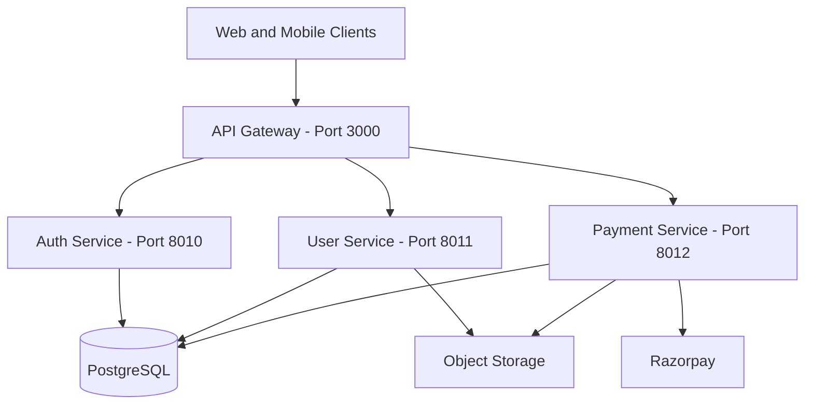

# POOJAWALA Backend API

POOJAWALA is a NestJS-based backend platform for devotional services and spiritual commerce, bringing together puja bookings, partner management, temple services, e-commerce, payment processing, and real-time application workflows.

[](https://nestjs.com/)
[](https://www.typescriptlang.org/)
[](https://nodejs.org/)
[](https://www.postgresql.org/)
[](https://typeorm.io/)
[](https://socket.io/)
[](https://razorpay.com/)

---

## Table of Contents

1. [Project Overview](#1-project-overview)
2. [Key Features](#2-key-features)
3. [Technology Stack](#3-technology-stack)
4. [System Architecture](#4-system-architecture)
5. [Microservices](#5-microservices)
6. [Project Structure](#6-project-structure)
7. [Getting Started](#7-getting-started)
8. [Environment Variables](#8-environment-variables)
9. [License](#9-license)

---

## 1. Project Overview

POOJAWALA is structured as a NestJS monorepo orchestrating domain-driven microservices behind a unified HTTP reverse proxy gateway. The platform enables devotees to book offline in-person pujas or online virtual rituals, purchase consecrated puja samagri, explore heritage temples, and consult verified astrologers.

All client traffic enters through the reverse proxy gateway on port 3000, which handles CORS resolution and routes requests to dedicated microservices for authentication, business logic, and payment processing. WebSocket upgrade requests are forwarded to the user service for real-time Socket.IO communication.

The system incorporates location-based service availability checking, candidate practitioner discovery using spatial distance and schedule availability filters, partial advance token deposits, automated Puppeteer PDF invoice generation, and multi-role access control with double-submit CSRF protection.

---

## 2. Key Features

* **Service Availability & Booking:** Pre-registration location validation by city and state, supporting both in-person and virtual fulfillment modes.
* **Purohit Dispatch & Matching:** Candidate Purohit discovery queries filtering by ritual qualification, operating service radius, and schedule conflict exclusion.
* **On-Site Verification:** Ritual commencement verified via a secure 4-digit code (`startOtp`) confirmed on-site upon the practitioner's physical arrival.
* **Spiritual E-Commerce:** Product catalog, persistent shopping cart, inventory stock validation, and order management with address snapshots.
* **Payments & Invoicing:** Razorpay payment links for token advances and full payments, HMAC-SHA256 webhook verification, and dynamic PDF tax invoices rendered via headless Puppeteer.
* **Authentication & RBAC:** Multi-role access control (`CUSTOMER`, `PUROHIT`, `ASTROLOGER`, `ADMIN`), Fast2SMS mobile OTPs, Google OAuth 2.0, HTTP-only cookies, and double-submit CSRF guards.
* **Real-Time Updates:** Live booking status updates and notification events delivered through Socket.IO rooms.
* **Temples & Schedules:** Heritage temple profiles and daily aarti timetable management.

---

## 3. Technology Stack

* **Runtime & Framework:** Node.js 20+ LTS, NestJS 11.0, TypeScript 5.7
* **Database & ORM:** PostgreSQL 14+, TypeORM 0.3 (SSL transport enabled)
* **Gateway & Networking:** Node.js reverse proxy (`http-proxy`), Socket.IO 4.8
* **Authentication:** Passport.js (`passport-jwt`, `passport-local`), bcrypt
* **Third-Party Integrations:** Razorpay Node SDK, AWS S3 / Vercel Blob, Puppeteer, Fast2SMS, Resend / Nodemailer
* **Process Management:** PM2 (`ecosystem.config.js`)
* **Testing:** Jest with `ts-jest`

---

## 4. System Architecture



---

## 5. Microservices

| Service | Port | Description |
| :--- | :--- | :--- |
| **Reverse Proxy** (`proxy.js`) | `3000` | Unified public entrypoint, CORS preflight handling, route forwarding, and WebSocket upgrade proxying. |
| **Auth Service** (`auth-service`) | `8010` | User registration, authentication, JWT tokens, Fast2SMS OTP delivery, Google OAuth, and cookie management. |
| **User Service** (`user-service`) | `8011` | Puja catalog, availability checks, bookings, Purohit discovery, e-commerce, temples, and Socket.IO gateway. |
| **Payment Service** (`payment-service`) | `8012` | Razorpay orders, payment links, webhook verification, Puppeteer PDF invoicing, and payout reconciliation. |

---

## 6. Project Structure

```
poojawala-api/
├── apps/
│   ├── auth-service/       # Authentication, OTPs, and OAuth (Port 8010)
│   ├── user-service/       # Core domain, bookings, store, temples, Socket.IO (Port 8011)
│   └── payment-service/    # Razorpay payments, webhooks, PDF invoices (Port 8012)
├── libs/
│   ├── common/             # Shared guards, interceptors, filters, and utilities
│   ├── database/           # PostgreSQL TypeORM configuration
│   ├── dtos/               # Shared request validation DTOs
│   ├── entities/           # Centralized TypeORM entity definitions
│   └── gateway/            # Socket.IO WebSocket gateway
├── proxy.js                # Reverse proxy gateway server (Port 3000)
├── ecosystem.config.js     # PM2 process management configuration
└── package.json            # Project dependencies and npm scripts
```

---

## 7. Getting Started

### Prerequisites

* **Node.js:** v20.0.0 or higher LTS
* **npm:** v9.0.0 or higher
* **PostgreSQL:** v14 or higher

### Installation

1. Clone the repository:
   ```bash
   git clone <repository-url>
   cd poojawala-api
   ```

2. Install dependencies:
   ```bash
   npm install
   ```

3. Create and configure your environment file:
   ```bash
   touch .env
   ```
   Populate `.env` with the required variables listed in [Section 8](#8-environment-variables).

### Running the Application

* **Development (All Services + Reverse Proxy):**
  ```bash
  npm run dev:with-proxy
  ```

* **Development (All Microservices Only):**
  ```bash
  npm run start:dev:all
  ```

* **Reverse Proxy Gateway (Port 3000):**
  ```bash
  npm run proxy
  ```

* **Individual Microservices:**
  ```bash
  npm run start:dev:auth     # Port 8010
  npm run start:dev:user     # Port 8011
  npm run start:dev:payment  # Port 8012
  ```

### Production Build and PM2

* **Compile Webpack bundles:**
  ```bash
  npm run build:all
  ```

* **Manage with PM2:**
  ```bash
  npm run pm2:start
  npm run pm2:status
  npm run pm2:logs
  npm run pm2:restart
  npm run pm2:stop
  ```

### Testing

```bash
# Run unit tests
npm test

# Run tests with coverage
npm run test:cov

# Run End-to-End tests
npm run test:e2e:auth
npm run test:e2e:user
npm run test:e2e:payment
```

---

## 8. Environment Variables

Configure these variables in your root `.env` file. Do not commit secrets or credentials to version control.

| Variable | Purpose |
| :--- | :--- |
| `NODE_ENV` | Application environment mode (`development`, `production`, `test`) |
| `AUTHENTICATION_PORT` | Listening port for `auth-service` (default `8010`) |
| `USER_MANAGEMENT_PORT` | Listening port for `user-service` (default `8011`) |
| `PAYMENT_MANAGEMENT_PORT` | Listening port for `payment-service` (default `8012`) |
| `PROXY_PORT` | Reverse proxy gateway listening port (default `3000`) |
| `ALLOWED_ORIGINS` | Comma-delimited list of permitted CORS web origins |
| `DB_HOST` | PostgreSQL server hostname |
| `DB_PORT` | PostgreSQL server port (default `5432`) |
| `DB_USERNAME` | PostgreSQL database user |
| `DB_PASSWORD` | PostgreSQL database password |
| `DB_NAME` | PostgreSQL database name |
| `JWT_ACCESS_SECRET` | Secret key used to sign and verify short-lived access tokens |
| `JWT_REFRESH_SECRET` | Secret key used to sign and verify long-lived refresh tokens |
| `RAZORPAY_KEY_ID` | Merchant Key ID provided by Razorpay |
| `RAZORPAY_KEY_SECRET` | Merchant Secret Key provided by Razorpay |
| `RAZORPAY_WEBHOOK_SECRET` | Secret key used to verify HMAC-SHA256 webhook signatures |
| `AWS_S3_BUCKET_NAME` | AWS S3 bucket name for media and invoice storage |
| `AWS_REGION` | AWS region where the S3 bucket is hosted |
| `AWS_ACCESS_KEY_ID` | AWS IAM access key ID |
| `AWS_SECRET_ACCESS_KEY` | AWS IAM secret access key |
| `FAST2SMS_API_KEY` | API authorization key for Fast2SMS mobile OTP delivery |
| `MAIL_FROM` | Sender identity email address for outbound notifications |
| `GOOGLE_CLIENT_ID` | Google OAuth 2.0 Client ID for social authentication |
| `GOOGLE_CLIENT_SECRET` | Google OAuth 2.0 Client Secret |
| `FRONTEND_URL` | Client web application origin for CORS and redirect links |
| `FRONTEND_PAYMENT_CALLBACK_URL` | Client redirect URL following payment completion |

---

## 9. License

No open-source license is declared in this repository. Refer to the project owner or maintainers for usage and distribution permissions.
